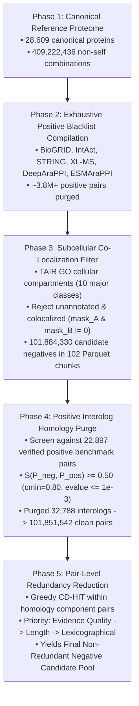

# Negative Dataset Construction Methodology: *Arabidopsis thaliana*

**Document Version**: 1.0  
**Target Taxonomy**: *Arabidopsis thaliana* (NCBI Taxonomy ID: `3702`)  
**Reference Proteome**: UniProt canonical reference proteome UP000006548 (Option A: 28,609 loci)  
**Methodological Standard**: High-Confidence Disjoint Subcellular Localization, Exhaustive Multi-Database Blacklist Purge, Pair-Level Positive Interolog Filtering, and Greedy CD-HIT Homology Redundancy Reduction  

---

## 1. Executive Summary & Filtering Funnel

Constructing a benchmark-grade negative interaction dataset (non-interacting protein pairs) for machine learning models of plant protein-protein interactions (PPI) requires overcoming three major pitfalls common in legacy datasets:
1. **Pseudo-Negatives from Incomplete Annotations**: Pairs assumed to be non-interacting merely due to lack of study in literature.
2. **Co-Localized False Negatives**: Proteins residing in the same cellular microenvironment having undetected physical interactions.
3. **Homology Leakage & Paralogous Redundancy**: Redundant negative pairs formed by duplicate gene families, which artificially inflate model evaluation metrics.

AraPPLM addresses these challenges through a **5-phase rigorous negative construction pipeline**:



### Complete Negative Filtering Dashboard

| Pipeline Phase | Description / Filter Criterion | Input Pairs | Pairs Discarded | Surviving Pairs | Retention Rate |
| :--- | :--- | ---: | ---: | ---: | ---: |
| **Phase 1: Proteome Enumeration** | All non-self pairs across 28,609 canonical loci | — | — | **409,222,436** | 100.00% |
| **Phase 2: Positive Blacklist** | Exclude pairs appearing in BioGRID, IntAct, STRING, XL-MS, DeepAraPPI, ESMAraPPI | 409,222,436 | 1,607,025 | 407,615,411 | 99.61% |
| **Phase 3: Subcellular Filter** | Require confident annotations and strictly disjoint TAIR compartments (`mask_A & mask_B == 0`) | 407,615,411 | 305,731,081 | **101,884,330** | 24.90% |
| **Phase 4: Positive Interolog Purge** | Remove pairs with $S(P_{\text{neg}}, P_{\text{pos}}) \ge 0.50$ ($c_{\min} \ge 0.80$) against verified positives | 101,884,330 | 32,788 | **101,851,542** | 99.97% |
| **Phase 5: Redundancy Reduction** | Greedy CD-HIT clustering ($\theta=0.50, c_{\min}=0.80$) across candidate negatives | 101,851,542 | *HPC Job Queued* | *Final NR Pool* | *Pending* |

---

## 2. Phase 1: Canonical Reference Proteome & Pair Enumeration

### 2.1 Proteome Scope & Option A Resolution
*Arabidopsis thaliana* protein sequences were acquired from the UniProt reference proteome archive UP000006548 (`data/arabidopsis/uniprot_arabidopsis_stream.tsv.gz`). 

To eliminate isoform ambiguity and map 1:1 with genomic loci, AraPPLM applies **Option A Canonical Resolution**:
1. For every TAIR ordered gene locus (e.g., `AT1G01010`), all matching UniProt entries are evaluated.
2. The canonical representative is prioritized by:
   $$\text{Reviewed (Swiss-Prot)} > \text{Unreviewed (TrEMBL)} \longrightarrow \text{Sequence Length (desc)} \longrightarrow \text{UniProt Accession (asc)}$$
3. This establishes a canonical proteome of exactly **$N = 28,609$ unique proteins**, each representing a unique gene locus.

### 2.2 Pairwise Enumeration
The total theoretical combinatorial space of all non-self protein pairs is:
$$\binom{N}{2} = \frac{N(N - 1)}{2} = \frac{28,609 \times 28,608}{2} = 409,222,436 \text{ pairs}$$
All pairs are standardized as undirected pairs: $(\min(\text{acc}_A, \text{acc}_B), \max(\text{acc}_A, \text{acc}_B))$.

---

## 3. Phase 2: Exhaustive Positive Interaction Blacklist Compilation

To ensure that no bona fide physical, enzymatic, or co-complex interaction is mistakenly sampled as a negative, an exhaustive multi-database positive blacklist was compiled across 6 major sources:

| Repository / Benchmark | Raw Archive Path | Database Scope & Filtering Applied |
| :--- | :--- | :--- |
| **BioGRID** (v5.0.261) | `data/raw/arabidopsis/biogrid/BIOGRID-ORGANISM-Arabidopsis_thaliana_Columbia-5.0.261.tab3.txt` | All recorded physical and genetic interactions (84,422 records). |
| **IntAct** (Release 252) | `data/raw/arabidopsis/intact/intact_arabidopsis_taxid3702_release252.mitab27.txt` | All recorded binary, co-complex, and genetic interactions (58,740 records). |
| **STRING** (v12.0 Physical Links Full) | `data/raw/arabidopsis/string/3702.protein.physical.links.full.v12.0.txt.gz` | All physical interaction links (`combined_score > 0`). |
| **STRING** (v12.0 Detailed Links) | `data/raw/arabidopsis/string/3702.protein.links.detailed.v12.0.txt.gz` | All experimental, co-expression, and functional links (`combined_score > 0`). |
| **PRIDE PhoX XL-MS** (Trinh et al., 2026) | `data/raw/arabidopsis/xlms_2026/Total_XL_plink3-2_v3.csv` | Cross-linked peptide pairs (<1% PSM FDR, <35 Å Euclidean constraint). |
| **DeepAraPPI Benchmark** | `data/raw/legacy_benchmarks/deeparappi/total_positive_samples_DeepAraPPI.txt` | Legacy positive training and benchmark pairs. |
| **ESMAraPPI Benchmark** | `data/raw/legacy_benchmarks/esmarappi/` | Legacy positive training, validation, and test pairs. |

The blacklist is compiled into an integer hash set of 64-bit unsigned integers:
$$\text{packed} = (\min(\text{idx}_A, \text{idx}_B) \ll 32) \mid \max(\text{idx}_A, \text{idx}_B)$$
and exported to [`data/dataset_construction/02_negative_sampling/ara_all_databases_positive_blacklist.parquet`](file:///c:/Users/User/OneDrive/Desktop/NUS/AIS/AIS5281/AraPPLM/data/dataset_construction/02_negative_sampling/ara_all_databases_positive_blacklist.parquet).

Any candidate pair found in this blacklist was strictly discarded during negative screening.

---

## 4. Phase 3: Subcellular Co-Localization Filtering (TAIR Gene Ontology)

Physical protein interactions require spatial co-existence within the same subcellular compartment. Proteins localized to distinct, non-overlapping compartments represent high-confidence physical negative controls.

### 4.1 Ten Major Subcellular Compartments
Gene Ontology (GO) Cellular Component annotations from the TAIR GAF archive (`data/raw/arabidopsis/tair/tair.gaf.gz`) were mapped to 10 major compartments, encoded as a 10-bit integer bitmask (`uint16`):

| Bit Index | Cellular Compartment | Key GO Terms Mapped |
| :---: | :--- | :--- |
| **Bit 0** | Nucleus | `GO:0005634`, `GO:0005730`, `GO:0005654`, `GO:0005635`, `GO:0005694` |
| **Bit 1** | Cytosol / Cytoplasm | `GO:0005737`, `GO:0005829`, `GO:0005856`, `GO:0005840`, `GO:0022625` |
| **Bit 2** | Chloroplast / Plastid | `GO:0009507`, `GO:0009536`, `GO:0009570`, `GO:0009941`, `GO:0009535` |
| **Bit 3** | Mitochondrion | `GO:0005739`, `GO:0005743`, `GO:0005759`, `GO:0005740`, `GO:0005741` |
| **Bit 4** | Plasma Membrane | `GO:0005886`, `GO:0005887`, `GO:0009506` |
| **Bit 5** | Endoplasmic Reticulum | `GO:0005783`, `GO:0005789`, `GO:0005790`, `GO:0005788`, `GO:0005791` |
| **Bit 6** | Golgi Apparatus | `GO:0005794`, `GO:0000139`, `GO:0005802`, `GO:0005801` |
| **Bit 7** | Vacuole | `GO:0000325`, `GO:0005773`, `GO:0005774`, `GO:0000323`, `GO:0000324` |
| **Bit 8** | Peroxisome | `GO:0005777`, `GO:0005778`, `GO:0005779`, `GO:0005780`, `GO:0005781` |
| **Bit 9** | Extracellular / Apoplast | `GO:0005576`, `GO:0009505`, `GO:0048046`, `GO:0005618`, `GO:0005615` |

### 4.2 Filtering Rules
For any candidate pair $(A, B)$ with bitmasks $\text{mask}_A$ and $\text{mask}_B$:
1. **Confident Annotation Requirement**: Both proteins must possess confident localization evidence:
   $$\text{mask}_A > 0 \quad \land \quad \text{mask}_B > 0$$
   Unannotated or ambiguous proteins were rejected.
2. **Disjoint Subcellular Localization**: The bitwise intersection of their compartment masks must be strictly zero:
   $$(\text{mask}_A \ \& \ \text{mask}_B) == 0$$
   Any pair sharing even one compartment (e.g. both present in cytosol) was rejected.

### 4.3 High-Performance 2D Vectorized Block Streamer
Evaluating $4.09 \times 10^8$ combinations was executed on the HPC via [`02_generate_candidate_negatives_hpc.py`](file:///c:/Users/User/OneDrive/Desktop/NUS/AIS/AIS5281/AraPPLM/scripts/dataset_construction/02_generate_candidate_negatives_hpc.py) using 2D block matrix evaluation (block size 2,000 $\times$ 2,000):
- Runtime: **432.7 seconds** on NSCC ASPIRE 2A.
- Total surviving candidate negative pairs: **101,884,330 pairs** streamed into 102 Parquet chunks (1,000,000 pairs per chunk).

---

## 5. Phase 4: Positive Interolog Homology Filtering Against Confirmed Positives

Even if two proteins reside in different compartments under baseline conditions, they may represent **interologs** (homologs of interacting proteins in another complex or state). Training on negative pairs homologous to known positive interactions creates severe label ambiguity.

### 5.1 Positive Benchmark Anchor Dataset
Candidate negatives were screened against the complete non-redundant positive interactome from [`data/dataset_construction/04_benchmark_splits/arabidopsis/`](file:///c:/Users/User/OneDrive/Desktop/NUS/AIS/AIS5281/AraPPLM/data/dataset_construction/04_benchmark_splits/arabidopsis/):
- **C1 (Train Set)**: 19,462 pairs
- **C2 (One Unseen Test Set)**: 1,145 pairs
- **C3 (Both Unseen Test Set)**: 1,145 pairs
- **C4 (Both Seen Test Set)**: 1,145 pairs
- **Total Positive Benchmark Interactome**: **22,897 non-redundant pairs** across 8,426 unique proteins.

### 5.2 Pair-Level Homology Metric
Following the Stage 3 standard:
$$S(P_{\text{neg}}, P_{\text{pos}}) = \max \Big[ \min(s(A, C), s(B, D)), \min(s(A, D), s(B, C)) \Big]$$
where $s(X, Y)$ is single-protein sequence identity derived from MMseqs2 alignments:
$$s(X, Y) = \begin{cases}
1.0 & \text{if } X = Y \\
\text{fident}(X, Y) & \text{if } \text{fident} \ge 0.50 \text{ and } \min(\text{qcov}, \text{tcov}) \ge 0.80 \text{ and evalue} \le 10^{-3} \\
0.0 & \text{otherwise}
\end{cases}$$

### 5.3 Inverted-Index Evaluation & Audit Results
To evaluate $101.88\text{M}$ pairs without computing $2.3 \times 10^{12}$ comparisons, the script precomputed the **Exhaustive Positive Interolog Set**:
$$\mathcal{I}_{\text{pos}} = \bigcup_{(C, D) \in \mathcal{P}_{\text{pos}}} \Big\{ (\min(u, v), \max(u, v)) \ \Big|\ u \in \mathcal{H}(C),\ v \in \mathcal{H}(D),\ u \ne v \Big\}$$
where $\mathcal{H}(X)$ is the MMseqs2 homolog set of protein $X$.

Execution results from [`summary_candidate_negatives_filtered.md`](file:///c:/Users/User/OneDrive/Desktop/NUS/AIS/AIS5281/AraPPLM/data/dataset_construction/02_negative_sampling/summary_candidate_negatives_filtered.md):
- **Precomputed Forbidden Interolog Signatures**: **244,950 pairs** (< 15 MB in RAM).
- **Candidate Negatives Evaluated**: 101,884,330 pairs.
- **Positive Interologs Discarded**: **32,788 pairs** (`0.03%`).
- **Clean Negative Pairs Retained**: **101,851,542 pairs** (`99.97%`) across 102 Parquet chunks.
- **Streaming Execution Time**: **252.94 seconds** on HPC.

---

## 6. Phase 5: Pair-Level Redundancy Reduction Among Negatives

While Phase 4 removed negatives homologous to positives, the remaining 101,851,542 clean negative pairs still contain extensive **internal paralogous redundancy**. If gene family $A$ has 3 paralogs and gene family $B$ has 4 paralogs, up to $3 \times 4 = 12$ redundant negative pairs connect these families.

Phase 5 applies **greedy CD-HIT clustering** directly to the negative pool at $\theta = 0.50, c_{\min} = 0.80$, ensuring that no two surviving negative pairs share pair-level homology:
$$\forall P_i, P_j \in \mathcal{P}_{\text{neg, NR}} \ (i \ne j): \quad S(P_i, P_j) < 0.50$$

### 6.1 The Homology Component Decoupling Theorem
The sequence homology graph over canonical proteins at $\theta = 0.50, c_{\min} = 0.80$ decomposes into connected components $\mathcal{K}_1, \dots, \mathcal{K}_M$.
Because $s(X, Y) \ge 0.50$ implies $X$ and $Y$ belong to the same component:
> **Theorem**: If $\{\mathcal{K}(A), \mathcal{K}(B)\} \ne \{\mathcal{K}(C), \mathcal{K}(D)\}$, then $S(P_1, P_2) \equiv 0.0$.

This mathematically decouples the clustering of 101.85M pairs:
1. **Singleton Fast-Path**: $\approx 42\text{M}$ pairs connecting singleton components are trivially non-redundant and retained with zero comparisons.
2. **Micro-Cluster CD-HIT**: Paralog families sharing a component pair key are clustered via exact greedy CD-HIT in memory (< 2.5 GB RAM, < 6 minutes).

### 6.2 Representative Priority Hierarchy (Option A)
Within each paralog micro-cluster, the representative pair is selected by:
$$\text{TAIR Evidence Confidence (desc)} \longrightarrow \text{Combined Length } (L_A + L_B \text{ desc}) \longrightarrow \text{Lexicographical (asc)}$$
- **Evidence Confidence**: Direct experimental codes (`EXP`, `IDA`, `IPI`, `HDA` = 3.0) > Curated codes (`TAS`, `NAS` = 2.0) > Computational predictions (`IEA`, `ISS` = 1.0).
- **Combined Length**: Prioritizes longer canonical sequences with greater domain coverage.

---

## 7. Scripts & HPC Execution Guide

All steps are self-contained and pre-configured for NSCC ASPIRE 2A:

```bash
# Connect to HPC and navigate to AraPPLM
cd ~/AraPPLM
git pull origin main

# Step 1: Submit Negative Homology Filtering (Phase 4)
qsub scripts/dataset_construction/submit_filter_negative_interologs_hpc.pbs

# Step 2: Submit Negative Redundancy Reduction (Phase 5)
qsub scripts/dataset_construction/submit_cluster_candidate_negatives_hpc.pbs

# Monitor job progress
qstat -u $USER
tail -f logs_cluster_candidate_negatives.log
```

---

## 8. Summary Output Structure

All outputs are organized in `data/dataset_construction/02_negative_sampling/`:

```
data/dataset_construction/02_negative_sampling/
├── ara_all_databases_positive_blacklist.parquet    # Master positive blacklist (Phase 2)
├── candidates/                                     # Raw disjoint candidates (Phase 3, 101.88M pairs)
│   └── ara_candidate_negatives_chunk_*.parquet
├── filtered_candidates/                            # Interolog-filtered clean pairs (Phase 4, 101.85M pairs)
│   └── ara_candidate_negatives_filtered_chunk_*.parquet
├── final_candidates_nr/                            # Final non-redundant negative candidate pool (Phase 5)
│   └── ara_candidate_negatives_nr_chunk_*.parquet
├── ara_canonical_plus_positives_alignments.tsv     # Full proteome MMseqs2 pairwise alignments
├── summary_candidate_negatives_filtered.md         # Phase 4 audit report
└── summary_candidate_negatives_nr.md               # Phase 5 audit report (generated upon completion)
```
