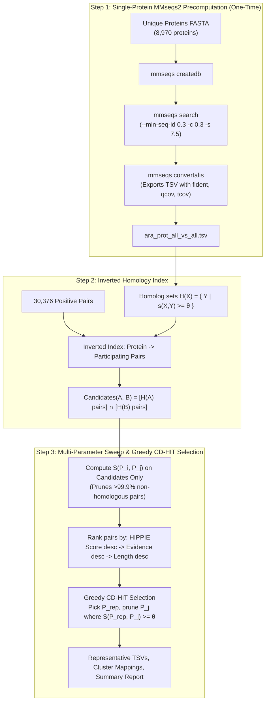

# Stage 3: Pair-Level Redundancy Reduction via MMseqs2

## 1. Overview

In protein-protein interaction (PPI) dataset construction, evaluating and training machine learning models on redundant interactions leads to severe data leakage and inflated performance. Homology at the single-protein level does not directly map to homology at the interaction level. 

Two interacting protein pairs $P_i = (A, B)$ and $P_j = (C, D)$ represent **homologous or redundant interactions** (e.g. duplicate gene paralog interactions, conserved protein complexes) if and only if **both** interacting partners share sequence homology.

This stage clusters and eliminates pair-level redundancy from the high-confidence Arabidopsis heteromeric dataset ([`ara_positive_pairs_high_only_hetero.tsv`](file:///c:/Users/User/OneDrive/Desktop/NUS/AIS/AIS5281/AraPPLM/data/dataset_construction/01_positive_pairs/arabidopsis/ara_positive_pairs_high_only_hetero.tsv), 30,376 pairs across 8,970 unique proteins).

---

## 2. Mathematical Formulation

### 2.1 Pair Similarity Function
For pairs $P_i = (A, B)$ and $P_j = (C, D)$, the pair-level similarity $S(P_i, P_j) \in [0, 1]$ is defined as:

$$S(P_i, P_j) = \max \Big[ \underbrace{\min(s(A, C), s(B, D))}_{\text{Orientation 1}}, \underbrace{\min(s(A, D), s(B, C))}_{\text{Orientation 2 (Symmetric)}} \Big]$$

where:
- $s(X, Y)$ is the sequence similarity between individual protein sequences $X$ and $Y$.
- The $\min$ operator requires **both** partners to share homology for the pair to be redundant.
- The $\max$ operator accounts for the undirected nature of physical interactions ($A-B \equiv B-A$).

### 2.2 Protein Similarity $s(X, Y)$
Single-protein similarity is derived from MMseqs2 alignments:
$$s(X, Y \mid \theta, c_{\min}) = \begin{cases} 
1.0 & \text{if } X = Y \\
\text{fident}(X, Y) & \text{if } \text{fident} \ge \theta \text{ and } \min(\text{qcov}, \text{tcov}) \ge c_{\min} \text{ and evalue} \le 10^{-3} \\
0.0 & \text{otherwise}
\end{cases}$$
where:
- $\theta$: Sequence identity threshold ($0.0 \le \theta \le 1.0$)
- $c_{\min}$: Minimum reciprocal coverage threshold ($0.0 \le c_{\min} \le 1.0$)

---

## 3. Algorithmic Architecture: Scaling with MMseqs2

Naive all-vs-all pair comparison requires $\binom{30,376}{2} = 461,335,800$ evaluations. Computing dynamic programming sequence alignments on $4.61 \times 10^8$ pairs would require over 100 CPU hours.

AraPPLM overcomes this with a **3-step accelerated pipeline**:



### Why candidate pruning is exact:
$S(P_i, P_j) \ge \theta$ strictly implies:
$$\big(s(A, C) \ge \theta \land s(B, D) \ge \theta\big) \lor \big(s(A, D) \ge \theta \land s(B, C) \ge \theta\big)$$
Thus, $P_j$ must belong to $\left( \bigcup_{X \in \mathcal{H}(A)} \text{Pairs}(X) \right) \cap \left( \bigcup_{Y \in \mathcal{H}(B)} \text{Pairs}(Y) \right)$. This reduces candidate evaluations from $4.61 \times 10^8$ to fewer than 50,000 checks, executing in seconds.

---

## 4. Parameter Sweep Grid

The pipeline evaluates 6 combinations across sequence identity and alignment coverage:

| Sequence Identity ($\theta$) | Coverage ($c_{\min}$) | Benchmark Purpose |
|:---:|:---:|---|
| **0.40** | **0.40** | Permissive coverage benchmark with 40% identity fold-level cutoff |
| **0.40** | **0.50** | **Primary Recommended Core Benchmark**: 40% identity, 50% domain-level coverage |
| **0.40** | **0.70** | Stringent coverage benchmark (requires 70% domain overlap) |
| **0.70** | **0.40** | Permissive coverage duplicate gene / paralog removal |
| **0.70** | **0.50** | **Relaxed Paralog Benchmark**: Prunes recent WGD gene duplicates while retaining family diversity |
| **0.70** | **0.70** | Stringent coverage paralog removal |

---

## 5. Execution on HPC

The scripts are self-contained and require no root permissions or manual path configuration.

### Option A: Interactive / Direct Execution on HPC Node
```bash
# 1. Connect to HPC and clone / pull repository
cd ~/AraPPLM
git pull origin main

# 2. Load MMseqs2 module (NSCC ASPIRE 2A or generic HPC)
module load mmseqs2 || true
module load python/3.10 || module load miniconda3 || true

# 3. Run the pipeline (specifying number of threads)
THREADS=16 bash scripts/dataset_construction/run_pair_clustering_pipeline.sh
```

### Option B: Batch Submission via PBS Pro (e.g., NSCC ASPIRE 2A)
```bash
# Submit the pre-configured PBS job script
qsub scripts/dataset_construction/submit_pair_clustering_hpc.pbs

# Monitor job status
qstat -u $USER

# Check output log
cat logs_pair_clustering.log
```

---

## 6. Output Artifacts and File Structure

Upon completion, outputs are organized in `data/dataset_construction/03_homology_clustering/arabidopsis/`:

```
data/dataset_construction/03_homology_clustering/arabidopsis/
├── summary_clustering_metrics.tsv     # Full tabular sweep metrics across all 6 grid combinations
├── summary_clustering_metrics.md      # Formatted Markdown comparative report
├── ara_positive_pairs_nr_id0_40_cov0_50.tsv  # Primary core non-redundant pairs (θ=0.40, c=0.50)
├── ara_positive_pairs_nr_id0_70_cov0_50.tsv  # Relaxed paralog-pruned pairs (θ=0.70, c=0.50)
├── ara_positive_pairs_nr_*.tsv        # Representative datasets for remaining grid combinations
└── mappings/
    ├── ara_pair_clusters_mapping_id0_40_cov0_50.tsv
    └── ara_pair_clusters_mapping_*.tsv # Maps all 30,376 pairs to cluster_id & similarity_to_rep
```

### Representative Pairs TSV Schema:
```tsv
participant_a_id	participant_b_id	cluster_id	hippie_score	evidence_count
AT1G01010	AT2G02020	1	0.9500	5
...
```

### Cluster Mapping TSV Schema:
```tsv
pair_id	participant_a_id	participant_b_id	cluster_id	is_representative	similarity_to_rep
1	AT1G01010	AT2G02020	1	1	1.0
2	AT1G01020	AT2G02030	1	0	0.7420
...
```
